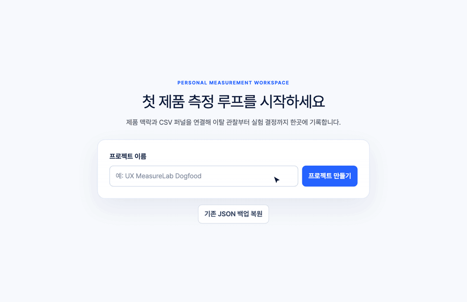
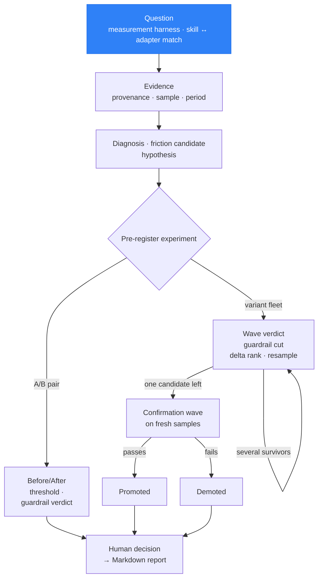
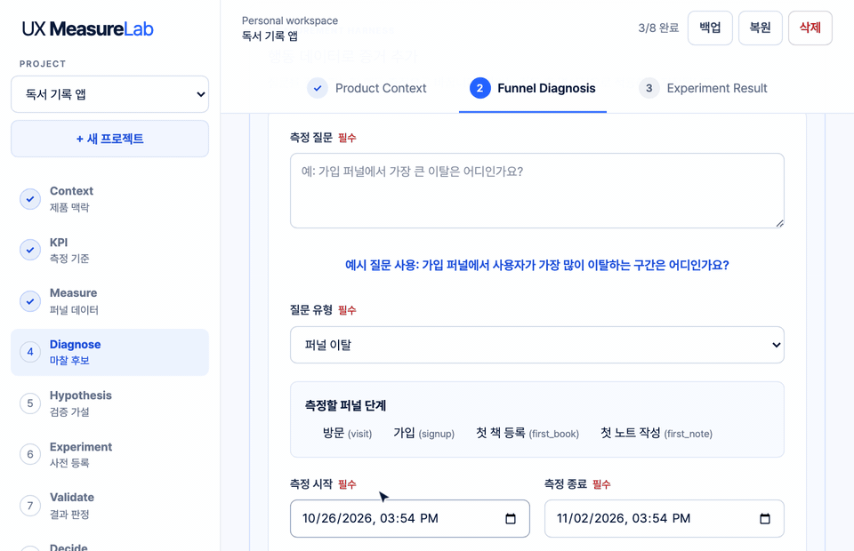
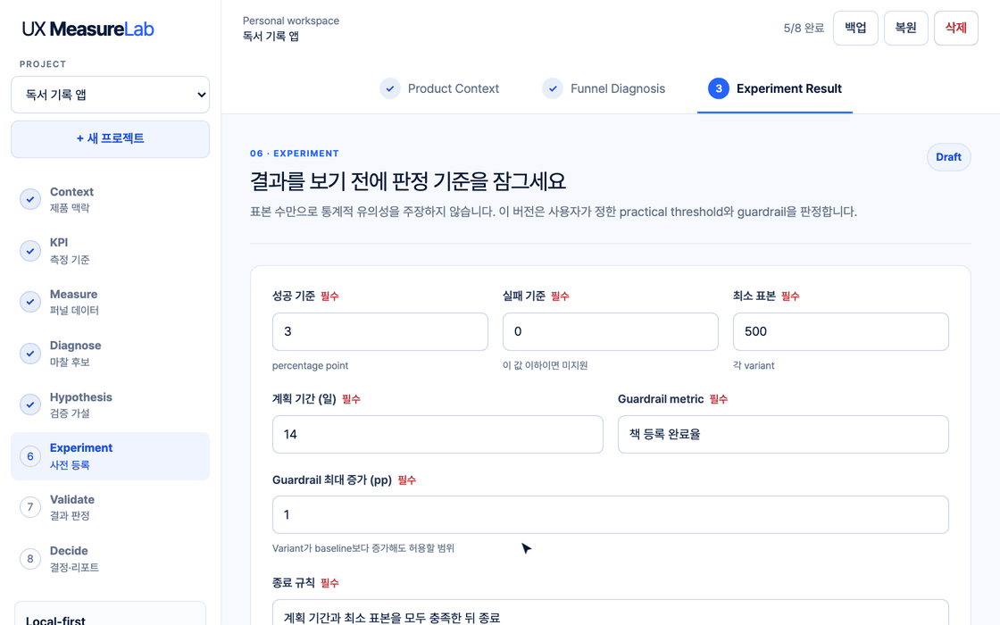
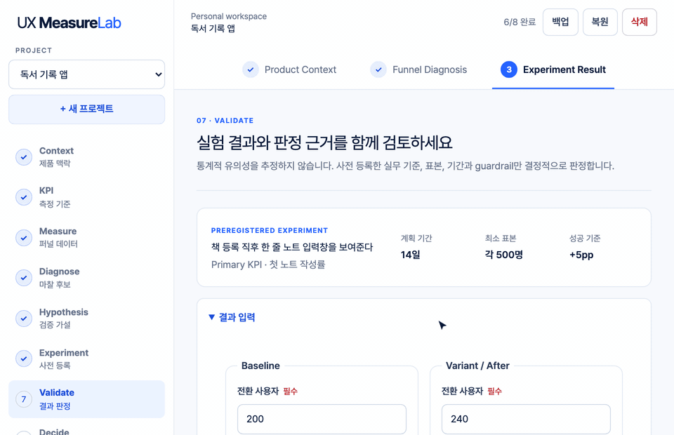
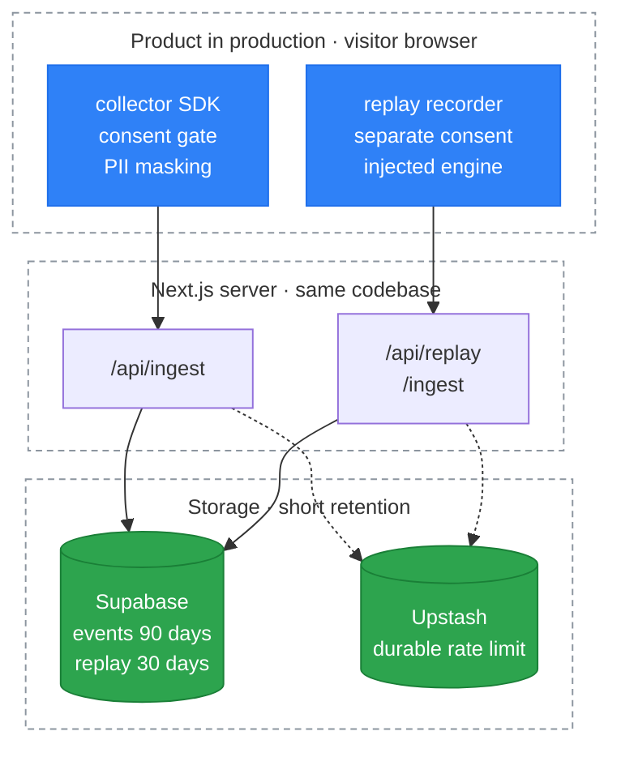
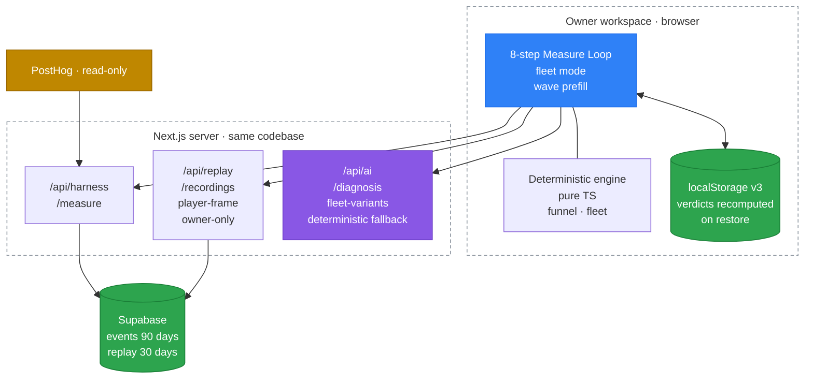

<div align="center">



# UX MeasureLab

**A workspace that turns UX questions into measurements, and measurements into pre-registered experiments and human decisions.**

Ask "where do people drop out of sign-up?" and it picks the right measurement and keeps the answer as sourced evidence.<br>
Code computes conversion, delta and verdicts. AI only proposes candidates, and a person records the decision.

[](https://github.com/Power-xc/ux-measure-lab/actions/workflows/quality.yml)


[](LICENSE)

**[Live demo](https://ux-measure-lab.vercel.app)** · [Measure Loop](#measure-loop) · [Features](#features) · [Quick start](#quick-start) · [Architecture](#architecture) · [한국어](README.md)

</div>

The app UI is in Korean. The screenshots below show the Korean interface; labels are translated in the text.

## At a glance

- **Measurement starts from a question** — the question type selects a measurement skill and a data source that can serve it. Results arrive as a draft with sample size, period and source attached, and only enter the project when you press "apply as evidence".
- **Code owns the numbers** — conversion, delta, guardrail and verdict are computed in TypeScript. Restoring a backup recomputes every stored verdict and rejects the file if any of them disagree.
- **Criteria before results** — success and failure thresholds, minimum sample, duration, guardrail and stop rule must be registered before a verdict can be computed. Too little sample or time yields "insufficient evidence".
- **Fleets for many variants** — register several variants at once and cut guardrail violators and low ranks wave by wave. The last survivor is promoted only after it passes a confirmation wave on fresh samples.
- **Your own events or existing tools** — a dependency-free collection SDK (consent gate, never reads input values) and a read-only PostHog adapter feed the same evidence schema.
- **Local-first** — projects autosave in the browser and back up to JSON. The whole eight-step loop works with AI switched off.

## Measure Loop

One project moves from context to decision along the step list on the left. A verdict needs a pre-registered experiment, and the report needs a recorded decision.

| Step | Screen     | What you do                                                                          | What remains                 |
| ---- | ---------- | ------------------------------------------------------------------------------------ | ---------------------------- |
| 1    | Context    | Product URL, core users, core value action, measurement goal                         | Product profile              |
| 2    | KPI        | Definition, formula, measurement period, data source                                 | Confirmed KPI                |
| 3    | Measure    | Upload a funnel CSV or run a harness measurement to get step conversion and drop-off | Funnel, largest drop-off     |
| 4    | Diagnose   | Separate observation, evidence, possible cause and missing evidence                  | Friction candidate, evidence |
| 5    | Hypothesis | Change, expected behavior, alternative explanation                                   | Testable hypothesis          |
| 6    | Experiment | Register success, failure, guardrail, sample, duration and stop rule (A/B or fleet)  | Pre-registered experiment    |
| 7    | Validate   | Enter before/after values for a practical-threshold verdict                          | Verdict                      |
| 8    | Decide     | Record the human decision and next action, export the report                         | Decision, Markdown report    |



## Features

### Measurement harness

**Question type → measurement skill → capability match → deterministic measurement → evidence draft.**



- **Questions it answers** — "Where is the biggest drop-off in the sign-up funnel?", "Do people repeat-click on the integration picker?", "Do new sign-ups reach the first core action?"
- **Four skills** — funnel drop-off, friction signals (rage and dead clicks), journey continuity and fleet readout. Each skill declares the data capabilities it needs (`funnel`, `interaction`, `paths`, `segments`) and each adapter declares what it provides, so only matching pairs can run.
- **No numbers without a sample** — under 30 observed samples the result is "insufficient sample" with no values. Evidence also carries a confidence band: low under 100 samples, medium under 1,000, high above.
- **Draft, then apply** — a measurement stays a draft until you apply it. Repeating the same question over a closed period reuses the session cache.
- **Sources are adapters** — the first-party SDK is adapter one and read-only PostHog is adapter two. A new source implements the same adapter contract and every existing skill works on it unchanged.

<details>
<summary>A measurement turned into evidence</summary>

```json
{
  "id": "harness-first-party-9b2e4c…-0",
  "sourceKind": "calculated",
  "direction": "context",
  "observation": "첫 책 등록에서 첫 노트 작성 사이의 이탈률은 63.9%로 관찰되었습니다.",
  "detail": "퍼널 전환 및 이탈 · completedUsers=430, enteredUsers=4200, largestDropOffRate=63.9, totalConversion=10.2 · 근거: 관찰 표본 4200개를 기준으로 한 순서형 등급입니다. · 한계: 표본 규모만 반영하며 인과관계나 통계적 유의성을 나타내지 않습니다.",
  "provenance": {
    "source": "UX MeasureLab Events",
    "observedAt": "2026-10-28T09:00:00.000Z",
    "period": "2026-10-01T00:00:00.000Z ~ 2026-10-28T00:00:00.000Z",
    "segment": "전체 사용자"
  },
  "sourceRef": {
    "adapterId": "first-party",
    "capability": "funnel",
    "queryHash": "9b2e4c…",
    "sampleSize": 4200,
    "confidence": "high"
  }
}
```

The funnel is the one in the demo: visit 4,200 → sign-up 2,310 → first book 1,190 → first note 430. The observation reads "the drop-off between first book and first note is 63.9%". `queryHash` is the SHA-256 of the normalized question, so you can trace which question, adapter and sample produced the evidence.

</details>

### Experiment fleet

**Filter many variants in waves under a pre-registered policy, then confirm the survivor on fresh samples.**



- **The policy you register** — success and failure thresholds (pp), minimum sample per variant, wave length, maximum active variants, keep share, total sample budget, holdout share, guardrail and stop rule.
- **Wave verdict order** — a guardrail violation is cut even with the best delta → a variant short of sample is resampled, never cut → rank by raw delta → cut by keep share. Each variant is judged by the same function as a single experiment (`evaluateExperiment`).
- **No promotion on the same data** — once one candidate is left, a confirmation wave runs on fresh samples and the candidate is demoted if it misses the bar.
- **Budget and holdout** — an allocation that overspends shows up as a negative remainder. The holdout share is never assigned to a variant, so cumulative effects stay visible.
- **Prefill from measurement** — per-variant conversions are aggregated from the variant key on first-party events and filled into the wave form (the fleet readout skill). Guardrail values are entered by hand.
- **AI variant candidates** — when enabled, it suggests variant copy grounded in existing evidence. A candidate becomes a variant only after a person reviews and adds it, and it never proposes numbers or verdicts.

<details>
<summary>Compared with bandit allocation and automated verdicts</summary>

| Aspect             | Probabilistic allocation, automated verdict | Experiment fleet                                            |
| ------------------ | ------------------------------------------- | ----------------------------------------------------------- |
| Variant candidates | Generated and launched automatically        | AI proposes, a person reviews and registers                 |
| Traffic            | Reallocated probabilistically               | Wave cuts under the pre-registered policy                   |
| Verdict            | Statistical estimate or model judgement     | Practical threshold computed in code, recomputed on restore |
| Winner             | Declared on the same data                   | Confirmation wave on fresh samples                          |
| Final decision     | Can be applied automatically                | Recorded by a person                                        |

Wave verdicts are uncorrected multiple comparisons, so each result shows how many variants were judged at the same time. Background research and the accepted and rejected options are in [Experiment Fleet Research](docs/research/experiment-fleet.md) and [ADR-0002](docs/adrs/0002-experiment-fleet.md).

</details>

### Pre-registration and verdicts

**The verdict depends only on the numbers registered before the experiment.**



| Verdict                 | Condition                                                                                                                       |
| ----------------------- | ------------------------------------------------------------------------------------------------------------------------------- |
| `insufficient_evidence` | Either group is below the minimum sample, or the observed period is shorter than planned                                        |
| `support`               | Delta at or above the success threshold and the guardrail passes                                                                |
| `partial_support`       | Delta at or above the success threshold but the guardrail fails, or below success yet above both the failure threshold and zero |
| `not_supported`         | None of the above                                                                                                               |

After the verdict a person picks Adopt, Iterate, Collect more data or Stop, with a rationale and a next action. The system recommendation and the human decision stay separate in the report.

<details>
<summary>Exported Markdown report</summary>

```markdown
# 독서 기록 앱 — Experiment Report

- Product: 독서 기록 앱
- Goal: 가입 후 첫 노트 작성률을 높인다
- Data source: funnel.csv
- Recorded: 2026-11-02T07:03:44.477Z

## KPI
첫 노트 작성률 — 가입한 사용자 중 7일 안에 첫 노트를 작성한 비율

## Funnel
| Step | Users |
|---|---:|
| 방문 | 4,200 |
| 가입 | 2,310 |
| 첫 책 등록 | 1,190 |
| 첫 노트 작성 | 430 |

## Evidence
- [calculated] 첫 책 등록 → 첫 노트 작성 구간에서 760명, 63.9%가 이탈했다. — funnel.csv

## Hypothesis
- Observation: 책을 등록한 사용자의 64%가 첫 노트 없이 이탈한다
- Change: 책 등록 직후 한 줄 노트 입력창을 보여준다
- Expected behavior: 등록 직후 첫 노트 작성이 늘어난다
- Alternative explanation: 책 등록 UI가 노트 기능을 가린다
- Missing evidence: 등록 후 화면 체류 시간

## Preregistered criteria
- Success: +5pp
- Failure: 0pp 이하
- Guardrail: 책 등록 이탈률 +1pp 이하
- Stop rule: 계획 기간과 최소 표본을 모두 충족한 뒤 종료

## Result
- Baseline: 18.6%
- Variant: 24%
- Absolute delta: 5.4pp
- Guardrail: pass
- Deterministic verdict: support

## Decision
- System recommendation: 사전 기준을 충족했습니다. 적용 범위를 정하고 guardrail을 계속 관찰하세요.
- Human decision: adopt
- Rationale: 첫 노트 작성률이 5.4%p 올랐고 guardrail은 유지됐다
- Next action: 신규 가입자 10%에게 먼저 배포한다
```

Section headings are fixed in English; the values are whatever the project recorded, Korean in this demo.

</details>

### Collection SDK and ingest

A script tag on the product you run collects page views, clicks, rage and dead clicks, scroll depth, route changes and sessions.

```html
<script>
  (function (w, d, s, k) {
    w.ml =
      w.ml ||
      function () {
        (w.ml.q = w.ml.q || []).push(arguments);
      };
    w.ml.k = k;
    var e = d.createElement(s);
    e.async = 1;
    e.src = "/ml.js";
    var f = d.getElementsByTagName(s)[0];
    f.parentNode.insertBefore(e, f);
  })(window, document, "script", "<site-key>");
  ml("init", { requireConsent: true, host: "/api/ingest" });
</script>
```

- **Consent first** — `requireConsent` is on by default and GPC and DNT signals are honored. Input values are never collected.
- **Write boundary** — `/api/ingest` checks a hashed site key and an Origin allowlist, caps batch size and applies a durable rate limit. Events are deleted after 90 days.
- **Closed without server config** — without Supabase and Upstash values, ingest returns 401 and measurements return an empty aggregate. The live demo runs this way.
- Site provisioning and the snippet come from `node scripts/provision-site.mjs`; operations are in the [Runbook](docs/runbook.md).

### Session replay

Records and replays the owner's own sessions to see the context around a drop-off. It is enabled only for one owner on loopback today.

- Recording consent is asked separately from collection consent, and the recording engine is not even loaded before consent.
- Masking happens three times: an engine-independent sanitizer at record time, whole-payload rejection of privacy violations at server ingest, and a scrub right before playback.
- Playback runs in a sandboxed frame with scripts, network and parent access blocked. Recordings are deleted after 30 days.
- Widening to a public cohort waits on sign-off of §4 of the [privacy impact assessment](docs/replay-privacy-impact.md).

## Quick start

Verified on Node 26.

```bash
npm ci
npm run dev
```

Open `http://127.0.0.1:3000`. The dev and local production servers bind to loopback only. Project data lives only in the current browser's `localStorage`, so download a JSON file with **백업** (Backup) for anything that matters.

### Funnel CSV

UTF-8, comma-separated, with this header order. One file is at most 1 MB and 100 steps, and user counts must not increase from the first step.

```csv
step_id,step_name,users
landing,랜딩 방문,1000
signup,가입 완료,540
core_action,핵심 행동,210
```

The in-app **샘플 사용** (use sample) and **템플릿 받기** (download template) buttons get you started without a file.

### Optional AI

AI drafts the diagnosis and hypothesis and proposes fleet variant candidates. The real provider runs only under `npm run dev` bound to loopback, after you opt in with server-only values in `.env.local`.

```bash
UX_MEASURE_AI_ENABLED=true
OPENAI_API_KEY=your_server_key
OPENAI_MODEL=gpt-5.6-luna
```

- The key is read only in server routes. Product URLs, raw HTML and raw CSV are never sent to the model.
- AI output may only reference existing evidence IDs and cannot change KPI values, thresholds, verdicts or the human decision.
- A missing key, a timeout, a provider error or failed output validation falls back to the deterministic draft. Production builds and public deployments always use the deterministic draft.

## Vocabulary

The UI, the report and the JSON backup use these values with one meaning each.

| Value                                                                     | Meaning                                                                    |
| ------------------------------------------------------------------------- | -------------------------------------------------------------------------- |
| `measured` · `calculated`                                                 | Counted by a collection tool · computed in code from those counts          |
| `qualitative` · `benchmark`                                               | Qualitative context such as sessions · an external reference value         |
| `assumed` · `inferred`                                                    | A stated assumption · inferred from other evidence, never treated as cause |
| `support` · `partial_support` · `not_supported` · `insufficient_evidence` | Verdicts                                                                   |
| `advance` · `cull` · `needs_sample`                                       | Fleet wave outcomes: promote to next wave · cut · resample                 |
| `insufficient_sample` · `not_configured` · `unsupported_capability`       | Why a measurement returned no values                                       |
| `adopt` · `iterate` · `collect_more_data` · `stop`                        | Human decisions                                                            |

## Architecture

Detailed design lives in [Architecture](docs/architecture.md) and the ADRs. This section keeps the overall picture and the reasons behind the main decisions.





### Why this stack

Next.js 16 App Router, React 19, TypeScript and CSS Modules, with `node:test` for unit tests. For a one-person, local-first project the runtime dependencies are Next, React and the replay engine; Supabase, Upstash and PostHog are all called with plain `fetch`. Verdict logic (conversion, delta, verdict) lives in framework-free TypeScript modules that `node --test` checks directly. Persistence is a versioned `localStorage` repository plus JSON backup. It is looser than a server database, but for a personal workspace data ownership and a clear recovery path matter more.

### Why this structure

Dependencies point one way: `entities → features → widgets`. Shared vocabulary (capability, verdict, evidence) has a single source in entities and features only re-export it. CSV, JSON, URLs, HTML, AI output and adapter responses all pass runtime validation at a trust boundary, and the AI suggestion path is separated in code from the deterministic computation path so AI cannot produce numbers. The harness and the fleet share the shape "declare a contract → match automatically → run deterministically" so that more sources and skills never require rewriting verdict code ([ADR-0001](docs/adrs/0001-decision-layer.md), [ADR-0002](docs/adrs/0002-experiment-fleet.md)).

The replay recording engine is injected through a contract (`RecordingEngine`) instead of being bundled into the SDK. That keeps the SDK at zero dependencies and keeps engine code from loading before consent. The playback frame sits on a loopback alias origin (workspace on 127.0.0.1, frame on localhost) because measurement forced it: in a fully opaque sandbox that allows only scripts, rrweb could not rebuild its child iframe, while the alias origin lets the browser enforce the cross-origin wall between frame and workspace and still lets the frame control its own rebuilt iframe.

### What we gave up

- **Our own analytics platform** — instead of building collection, query and replay infrastructure first, it started as a decision layer on top of existing tools, trading control for speed of validation (ADR-0001).
- **Bandit allocation and AI verdicts** — considered for large-scale experiments, but probabilistic allocation is hard to reproduce and audit, so it uses deterministic successive halving (ADR-0002).
- **Automatic p-value verdicts** — easy to misuse on low-traffic products, replaced by practical thresholds with sample and duration discipline.
- **Auth, team collaboration, server sync** — outside the personal v1 scope, with row-level security as a precondition for any multi-user version.

## Status

| Area                                                             | Status                                                                                                     |
| ---------------------------------------------------------------- | ---------------------------------------------------------------------------------------------------------- |
| Eight-step loop, deterministic verdicts, backup, restore, report | Built                                                                                                      |
| Measurement harness, adapter contract, workspace schema v3       | Built — four skills available; before/after, KPI trend, segment gap and replay context are catalogued only |
| Collection SDK and ingest                                        | Built — live collection verified locally; the public demo runs without server config                       |
| Read-only PostHog adapter                                        | Built — not yet verified against a real account                                                            |
| Experiment fleet, holdout, confirmation wave, AI candidates      | Built                                                                                                      |
| Session replay                                                   | Built — owner loopback dogfood only; public cohort after the privacy sign-off                              |
| Auth and team workspaces                                         | Out of scope                                                                                               |

Status follows the execution evidence in [Verification](docs/verification.md).

### Limits

- It does not decide statistical significance or causality. A verdict looks only at the pre-registered practical threshold, sample, duration and guardrail.
- URL analysis extracts limited text context from a single public HTML page. Journeys across the product need behavioral data.
- Clearing browser data deletes the local workspace. The JSON backup is the recovery path.
- There are no company permissions, collaboration, audit log or server sync.

## Verification

```bash
npm run typecheck
npm run lint
npm test            # 235 unit tests
npm run test:sdk    # 83 SDK tests
npm run build
npm audit --omit=dev
npm run test:e2e    # 10 Playwright tests
```

Unit tests cover CSV, funnels, experiment verdicts, repository invariants, URL and AI trust boundaries, the harness contract, measurement skills, the PostHog adapter, the ingest validation pipeline, the fleet engine (pre-registration, wave cuts, allocation, holdout, confirmation wave, recompute on restore) and replay boundaries (privacy rejection, retention, deletion, owner-only reads, playback scrub). SDK tests cover the consent gate, masking, detection rules, sessions, transport and the replay recorder. End-to-end tests run against a production build: the full eight steps, reload recovery, keyboard access, a 390 px layout, harness measurement, the fleet flow and sandbox isolation of the real replay bundle. CI runs the same commands on every push.

The GIFs in this README are recordings of the running app made by the scripts in [`demos/`](demos/), so they can be regenerated with one command when the UI changes.

## Documents

| Document                                                                                              | Contents                                                           |
| ----------------------------------------------------------------------------------------------------- | ------------------------------------------------------------------ |
| [Product Brief](docs/product-brief.md)                                                                | User problem, first users, success definition                      |
| [Architecture](docs/architecture.md) · [Data Model](docs/data-model.md)                               | Layers, trust boundaries, storage schema                           |
| [Security](docs/security.md) · [Runbook](docs/runbook.md)                                             | Threat model, operating limits, provisioning                       |
| [Verification](docs/verification.md)                                                                  | Test inventory, browser, deployment and live evidence              |
| [Specs](docs/specs/)                                                                                  | Personal v1, measurement harness, experiment fleet, session replay |
| [Research](docs/research/)                                                                            | Design research and claim audit                                    |
| [ADR-0001](docs/adrs/0001-decision-layer.md) · [ADR-0002](docs/adrs/0002-experiment-fleet.md)         | Decision layer, experiment fleet                                   |
| [Replay Privacy Impact](docs/replay-privacy-impact.md) · [Dogfood Template](docs/dogfood-template.md) | Replay impact assessment, dogfood log template                     |

The design documents are written in Korean.

## License

[MIT](LICENSE)
