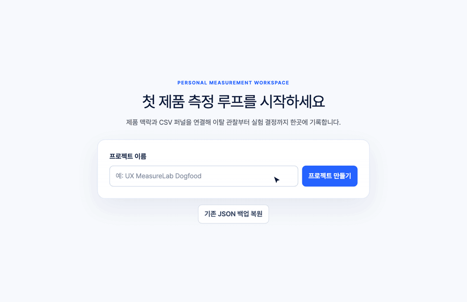
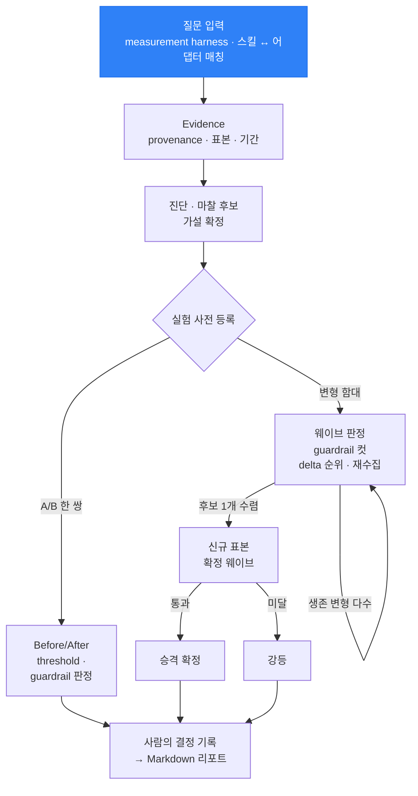
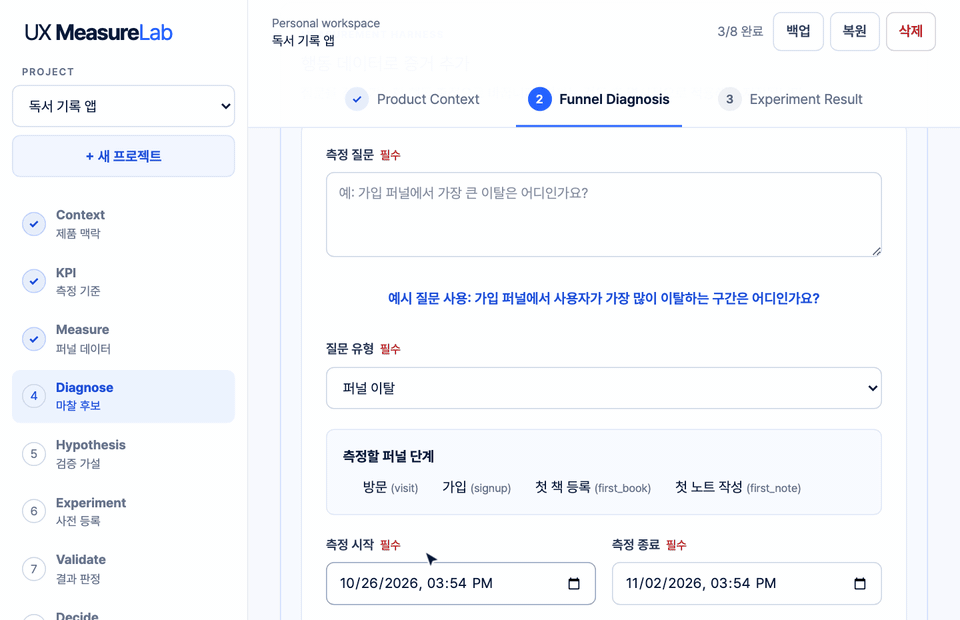
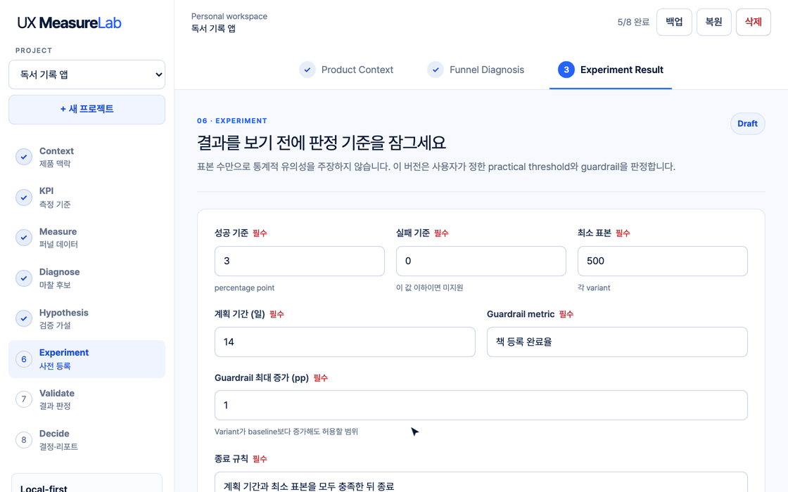
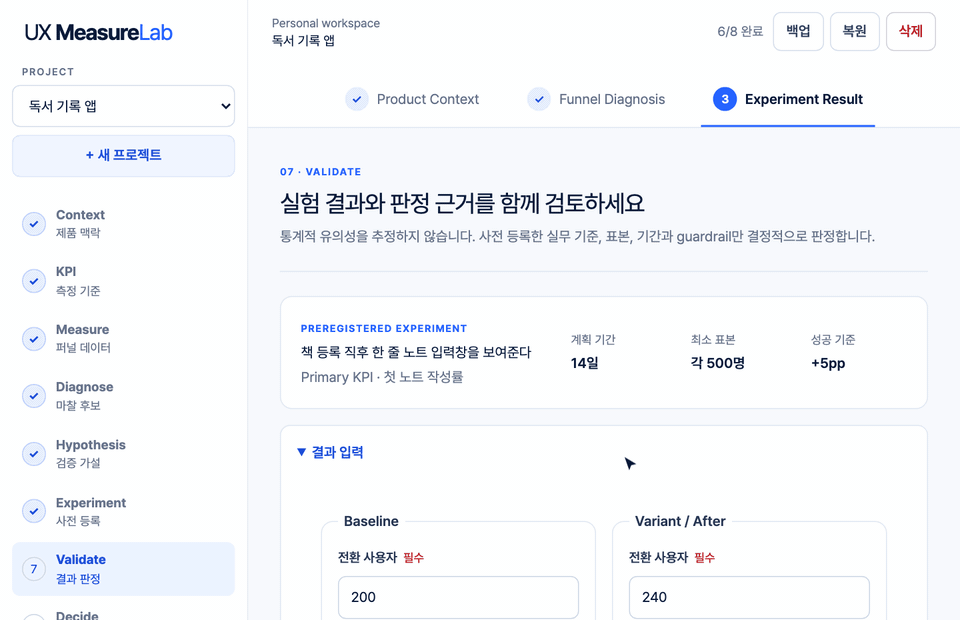
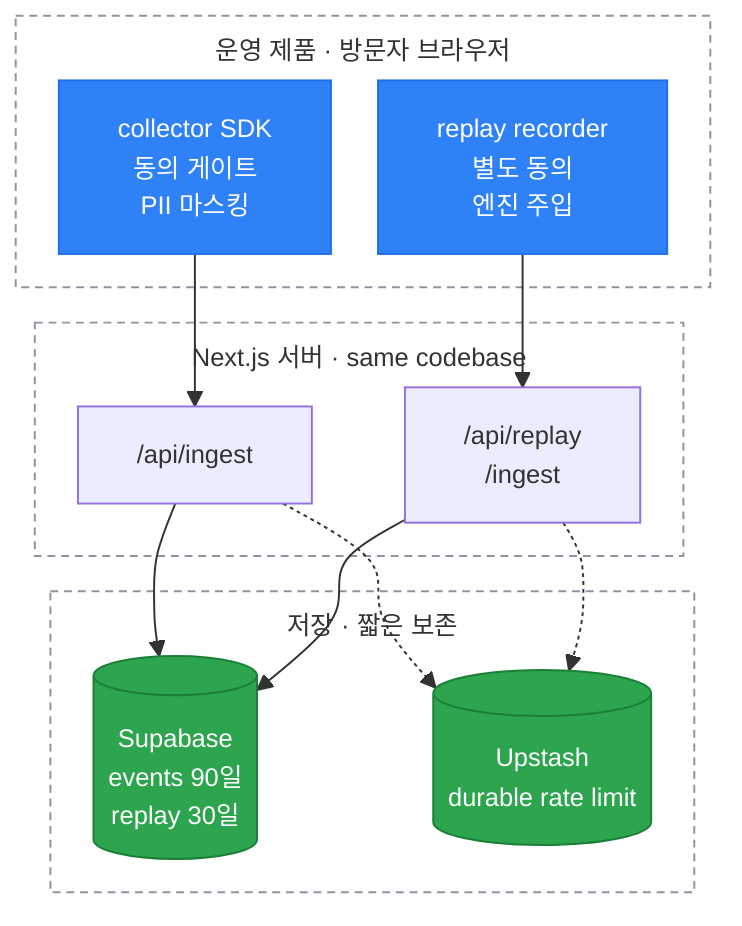
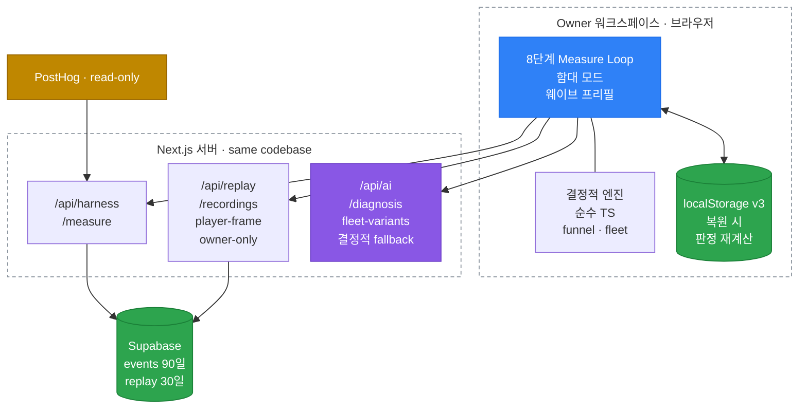

<div align="center">



# UX MeasureLab

**UX 질문을 측정으로, 측정을 사전 등록한 실험과 사람의 결정으로 잇는 워크스페이스.**

「가입 퍼널 어디서 새나요?」 같은 질문을 넣으면 맞는 측정을 골라 출처 붙은 근거로 남깁니다.<br>
전환율 · delta · 판정은 코드가 계산하고, AI는 후보만 내고, 결정은 사람이 기록합니다.

[](https://github.com/Power-xc/ux-measure-lab/actions/workflows/quality.yml)


[](LICENSE)

**[라이브 데모](https://ux-measure-lab.vercel.app)** · [Measure Loop](#measure-loop) · [기능](#기능) · [빠른 시작](#빠른-시작) · [아키텍처](#아키텍처) · [English](README.en.md)

</div>

## 한눈에

- **질문으로 시작하는 측정** — 질문 유형에 맞는 측정 스킬과 데이터 소스를 짝지어 실행하고, 결과를 표본 · 기간 · 출처가 붙은 Evidence 초안으로 보여 줍니다. 프로젝트에 넣는 것은 사람이 「Evidence로 적용」을 눌렀을 때뿐입니다.
- **판정은 코드가** — 전환율, delta, guardrail, verdict를 TypeScript가 계산합니다. 백업을 복원할 때도 저장된 판정을 다시 계산해 보고, 맞지 않으면 복원을 거부합니다.
- **기준을 먼저 등록** — 성공 · 실패 기준, 최소 표본, 기간, guardrail, 종료 규칙을 등록해야 판정이 열립니다. 표본이나 기간이 모자라면 결과는 「근거 부족」으로 남습니다.
- **변형이 많으면 함대로** — 변형 여러 개를 한 번에 등록해 웨이브마다 guardrail 위반과 하위 순위를 걸러 냅니다. 마지막 1개는 새 표본의 확정 웨이브를 통과해야 승격됩니다.
- **자체 수집과 기존 도구** — 의존성 없는 수집 SDK(동의 게이트 · 입력값 미수집)와 PostHog read-only 어댑터의 결과가 같은 Evidence 스키마로 들어옵니다.
- **로컬 우선** — 프로젝트는 브라우저에 자동 저장되고 JSON으로 백업 · 복원합니다. AI를 켜지 않아도 8단계를 끝까지 쓸 수 있습니다.

## Measure Loop

왼쪽 단계 표시를 따라 한 프로젝트를 처음부터 결정까지 진행합니다. 판정은 사전 등록한 실험이 있어야 계산되고, 리포트는 결정까지 기록해야 내보낼 수 있습니다.

| 단계 | 화면       | 하는 일                                                                             | 남는 것                |
| ---- | ---------- | ----------------------------------------------------------------------------------- | ---------------------- |
| 1    | Context    | 제품 URL · 핵심 사용자 · 핵심 가치 행동 · 측정 목표를 정합니다                      | 제품 프로필            |
| 2    | KPI        | 정의 · 계산식 · 측정 기간 · 데이터 출처를 확정합니다                                | 확정 KPI               |
| 3    | Measure    | 퍼널 CSV를 올리거나 하네스로 측정해 단계별 전환과 이탈을 계산합니다                 | 퍼널 · 최대 이탈 구간  |
| 4    | Diagnose   | 관찰 · 근거 · 가능한 원인 · 빠진 근거를 나눠 마찰 후보를 씁니다                     | 마찰 후보 · Evidence   |
| 5    | Hypothesis | 변경안 · 예상 행동 · 대안 설명을 갖춘 가설을 확정합니다                             | 검증 가설              |
| 6    | Experiment | 성공 · 실패 · guardrail · 표본 · 기간 · 종료 규칙을 등록합니다(A/B 한 쌍 또는 함대) | 사전 등록 실험         |
| 7    | Validate   | 변경 전후 값을 넣으면 practical threshold로 판정합니다                              | verdict                |
| 8    | Decide     | 사람의 결정과 다음 행동을 기록하고 리포트를 내보냅니다                              | 결정 · Markdown 리포트 |



## 기능

### 측정 하네스

**질문 유형 → 측정 스킬 → 데이터 능력 매칭 → 결정적 측정 → Evidence 초안.**



- **이럴 때** — 「가입 퍼널에서 가장 큰 이탈은 어디인가요?」, 「연동 방식 선택 화면에서 반복 클릭이 보이나요?」, 「가입한 사용자가 첫 핵심 행동까지 이어지나요?」
- **스킬 4종** — 퍼널 이탈 · 마찰 신호(rage · dead click) · 여정 연속성 · 함대 판독. 스킬은 필요한 데이터 능력(`funnel` · `interaction` · `paths` · `segments`)을 선언하고 어댑터는 제공하는 능력을 선언해서, 실행 전에 짝이 맞는 조합만 고를 수 있습니다.
- **표본이 모자라면 숫자를 만들지 않음** — 관찰 표본이 30개보다 적으면 수치 없이 「표본 부족」을 돌려줍니다. 표본 100개 미만은 신뢰도 low, 1,000개 미만은 medium으로 Evidence에 함께 적힙니다.
- **초안과 적용을 분리** — 측정 결과는 초안으로 머물고, 적용을 눌러야 저장됩니다. 끝난 기간의 같은 질문은 세션 캐시를 다시 씁니다.
- **소스는 어댑터로** — first-party SDK가 1호, PostHog read-only가 2호 어댑터입니다. 새 소스는 같은 어댑터 계약을 구현하면 기존 스킬이 그대로 동작합니다.

<details>
<summary>측정 결과가 Evidence가 된 모습</summary>

```json
{
  "id": "harness-first-party-9b2e4c…-0",
  "sourceKind": "calculated",
  "direction": "context",
  "observation": "첫 책 등록에서 첫 노트 작성 사이의 이탈률은 63.9%로 관찰되었습니다.",
  "detail": "퍼널 전환 및 이탈 · completedUsers=430, enteredUsers=4200, largestDropOffRate=63.9, totalConversion=10.2 · 근거: 관찰 표본 4200개를 기준으로 한 순서형 등급입니다. · 한계: 표본 규모만 반영하며 인과관계나 통계적 유의성을 나타내지 않습니다.",
  "provenance": {
    "source": "UX MeasureLab Events",
    "observedAt": "2026-10-28T09:00:00.000Z",
    "period": "2026-10-01T00:00:00.000Z ~ 2026-10-28T00:00:00.000Z",
    "segment": "전체 사용자"
  },
  "sourceRef": {
    "adapterId": "first-party",
    "capability": "funnel",
    "queryHash": "9b2e4c…",
    "sampleSize": 4200,
    "confidence": "high"
  }
}
```

데모와 같은 퍼널(방문 4,200 → 가입 2,310 → 첫 책 등록 1,190 → 첫 노트 작성 430)을 측정한 결과입니다. `queryHash`는 정규화한 질문의 SHA-256이라, 이 근거가 어떤 질문 · 어댑터 · 표본에서 나왔는지 나중에 되짚을 수 있습니다.

</details>

### 실험 함대

**사전 등록한 정책 아래에서 변형 여러 개를 웨이브로 걸러 내고, 남은 1개는 새 표본으로 한 번 더 확인합니다.**



- **등록하는 정책** — 성공 · 실패 기준(pp), 변형별 최소 표본, 웨이브 기간, 동시 변형 상한, 생존 비율, 전체 표본 예산, holdout 몫, guardrail, 종료 규칙.
- **웨이브 판정 순서** — guardrail 위반은 delta가 가장 높아도 컷 → 표본이 모자란 변형은 컷하지 않고 재수집 → 원시 delta 순위 → 생존 비율 컷. 변형별 판정은 단일 실험과 같은 함수(`evaluateExperiment`)를 씁니다.
- **같은 데이터로 승격하지 않음** — 후보가 1개로 모이면 새 표본으로 확정 웨이브를 한 번 더 돌리고, 기준에 못 미치면 강등합니다.
- **예산과 holdout** — 예산을 넘긴 배분은 음수로 그대로 드러냅니다. holdout 몫은 어떤 변형에도 배정하지 않아 누적 효과를 볼 수 있습니다.
- **측정에서 바로 채우기** — first-party 이벤트의 변형 배정 키로 변형별 전환을 집계해 웨이브 입력을 채웁니다(함대 판독 스킬). guardrail 값은 직접 넣습니다.
- **AI 변형 후보** — 켜 두면 Evidence를 근거로 변형 문구 후보를 받습니다. 후보는 사람이 검토해 목록에 넣어야 변형이 되고, 수치와 판정은 제안하지 않습니다.

<details>
<summary>밴딧 · 자동 판정 방식과 비교</summary>

| 항목      | 확률 배분 · 자동 판정    | experiment fleet                                            |
| --------- | ------------------------ | ----------------------------------------------------------- |
| 변형 후보 | 생성 후 자동 투입        | AI는 제안만, 사람이 검토해 등록                             |
| 트래픽    | 확률적으로 다시 배분     | 사전 등록 정책의 웨이브 컷                                  |
| 판정      | 통계 추정 또는 모델 판단 | practical threshold를 코드가 계산, 복원 때 다시 계산해 대조 |
| 승자 확정 | 같은 데이터로 선언       | 신규 표본 확정 웨이브                                       |
| 최종 결정 | 자동 반영 가능           | 사람이 기록                                                 |

웨이브 판정은 보정하지 않은 다중 비교라서, 결과 옆에 동시에 판정한 변형 수를 함께 적습니다. 배경 조사와 채택 · 기각 근거는 [Experiment Fleet Research](docs/research/experiment-fleet.md)와 [ADR-0002](docs/adrs/0002-experiment-fleet.md)에 있습니다.

</details>

### 사전 등록과 판정

**판정 규칙은 실험 전에 등록한 숫자로만 정해집니다.**



| 판정                 | 조건                                                                                           |
| -------------------- | ---------------------------------------------------------------------------------------------- |
| 근거 부족            | 두 집단 중 하나라도 최소 표본에 못 미치거나, 관찰 기간이 계획보다 짧음                         |
| 가설 지지            | delta가 성공 기준 이상이고 guardrail 통과                                                      |
| 부분 지지            | delta가 성공 기준 이상이지만 guardrail 위반, 또는 성공 기준엔 못 미치지만 실패 기준과 0보다 큼 |
| 가설을 지지하지 않음 | 위에 해당하지 않음                                                                             |

판정 다음에는 사람이 Adopt · Iterate · Collect more data · Stop 중 하나와 근거, 다음 행동을 적습니다. 시스템 권고와 사람의 결정은 리포트에 따로 남습니다.

<details>
<summary>내보낸 Markdown 리포트</summary>

```markdown
# 독서 기록 앱 — Experiment Report

- Product: 독서 기록 앱
- Goal: 가입 후 첫 노트 작성률을 높인다
- Data source: funnel.csv
- Recorded: 2026-11-02T07:03:44.477Z

## KPI
첫 노트 작성률 — 가입한 사용자 중 7일 안에 첫 노트를 작성한 비율

## Funnel
| Step | Users |
|---|---:|
| 방문 | 4,200 |
| 가입 | 2,310 |
| 첫 책 등록 | 1,190 |
| 첫 노트 작성 | 430 |

## Evidence
- [calculated] 첫 책 등록 → 첫 노트 작성 구간에서 760명, 63.9%가 이탈했다. — funnel.csv

## Hypothesis
- Observation: 책을 등록한 사용자의 64%가 첫 노트 없이 이탈한다
- Change: 책 등록 직후 한 줄 노트 입력창을 보여준다
- Expected behavior: 등록 직후 첫 노트 작성이 늘어난다
- Alternative explanation: 책 등록 UI가 노트 기능을 가린다
- Missing evidence: 등록 후 화면 체류 시간

## Preregistered criteria
- Success: +5pp
- Failure: 0pp 이하
- Guardrail: 책 등록 이탈률 +1pp 이하
- Stop rule: 계획 기간과 최소 표본을 모두 충족한 뒤 종료

## Result
- Baseline: 18.6%
- Variant: 24%
- Absolute delta: 5.4pp
- Guardrail: pass
- Deterministic verdict: support

## Decision
- System recommendation: 사전 기준을 충족했습니다. 적용 범위를 정하고 guardrail을 계속 관찰하세요.
- Human decision: adopt
- Rationale: 첫 노트 작성률이 5.4%p 올랐고 guardrail은 유지됐다
- Next action: 신규 가입자 10%에게 먼저 배포한다
```

</details>

### 수집 SDK와 ingest

운영 중인 제품에 스크립트를 넣으면 페이지뷰 · 클릭 · rage · dead click · 스크롤 · 경로 이동 · 세션을 모읍니다.

```html
<script>
  (function (w, d, s, k) {
    w.ml =
      w.ml ||
      function () {
        (w.ml.q = w.ml.q || []).push(arguments);
      };
    w.ml.k = k;
    var e = d.createElement(s);
    e.async = 1;
    e.src = "/ml.js";
    var f = d.getElementsByTagName(s)[0];
    f.parentNode.insertBefore(e, f);
  })(window, document, "script", "<site-key>");
  ml("init", { requireConsent: true, host: "/api/ingest" });
</script>
```

- **동의가 먼저** — `requireConsent`가 기본으로 켜져 있고 GPC · DNT 신호를 존중합니다. 입력값은 어떤 경우에도 모으지 않습니다.
- **쓰기 경계** — `/api/ingest`는 사이트 키 해시와 Origin 허용 목록을 확인하고, 배치 크기 상한과 durable rate limit을 둡니다. 이벤트는 90일 뒤 지웁니다.
- **서버 설정이 없으면 닫힘** — Supabase · Upstash 값이 없으면 ingest는 401을, 측정은 빈 집계를 돌려줍니다. 라이브 데모가 이 상태입니다.
- 사이트 프로비저닝과 스니펫 발급은 `node scripts/provision-site.mjs`, 운영 절차는 [Runbook](docs/runbook.md)에 있습니다.

### 세션 리플레이

이탈 구간의 맥락을 보려고 owner 자신의 세션을 녹화 · 재생하는 기능입니다. 지금은 owner 1인의 loopback 환경에서만 켜집니다.

- 녹화 동의를 수집 동의와 따로 받고, 녹화 엔진은 동의 전에는 불러오지도 않습니다.
- 기록할 때 엔진과 무관한 마스킹을 한 번, 서버 ingest에서 개인정보가 섞인 payload 전체 거부를 한 번, 재생 직전 스크럽을 한 번 더 합니다.
- 재생은 스크립트 · 네트워크 · 부모 창 접근을 막은 sandbox 프레임에서 하고, 녹화는 30일 뒤 지웁니다.
- 공개 cohort로 넓히는 일은 [개인정보 영향평가](docs/replay-privacy-impact.md) §4 서명 이후로 남겨 두었습니다.

## 빠른 시작

Node 26에서 검증했습니다.

```bash
npm ci
npm run dev
```

`http://127.0.0.1:3000`을 엽니다. 개발 서버와 로컬 production 서버는 loopback에만 바인딩합니다. 프로젝트 데이터는 현재 브라우저의 `localStorage`에만 저장되니, 중요한 작업은 상단 **백업**으로 JSON 파일을 받아 두세요.

### 퍼널 CSV

UTF-8 쉼표 구분, 아래 헤더 순서를 씁니다. 파일 하나는 1MB · 100단계 이하이고, 사용자 수는 첫 단계부터 줄거나 같아야 합니다.

```csv
step_id,step_name,users
landing,랜딩 방문,1000
signup,가입 완료,540
core_action,핵심 행동,210
```

앱의 **샘플 사용**과 **CSV 템플릿 다운로드**로 바로 시작할 수도 있습니다.

### 선택적 AI 설정

AI는 진단 · 가설 초안과 함대 변형 후보를 제안합니다. 실제 provider는 loopback에 바인딩된 `npm run dev`에서만 켜지고, `.env.local`에 서버 전용 값을 넣어 명시적으로 활성화합니다.

```bash
UX_MEASURE_AI_ENABLED=true
OPENAI_API_KEY=your_server_key
OPENAI_MODEL=gpt-5.6-luna
```

- 키는 서버 route에서만 읽고, 제품 URL · raw HTML · raw CSV는 AI 요청에 넣지 않습니다.
- AI 출력은 이미 있는 Evidence ID만 참조할 수 있고 KPI 수치 · threshold · verdict · 사람의 결정을 바꿀 수 없습니다.
- 키가 없거나 timeout · provider 오류 · 출력 검증 실패가 나면 결정적 초안으로 돌아갑니다. production 빌드와 공개 배포는 설정이 있어도 항상 결정적 초안을 씁니다.

## 판정 어휘

화면 · 리포트 · 백업 JSON에서 같은 값을 같은 뜻으로 씁니다.

| 어휘                                                                      | 뜻                                                                 |
| ------------------------------------------------------------------------- | ------------------------------------------------------------------ |
| `measured` · `calculated`                                                 | 수집 도구가 센 값 · 그 값으로 코드가 계산한 값                     |
| `qualitative` · `benchmark`                                               | 세션 맥락 같은 정성 근거 · 외부 기준값                             |
| `assumed` · `inferred`                                                    | 사람이 둔 가정 · 다른 근거에서 추론한 값 — 원인으로 단정하지 않음  |
| `support` · `partial_support` · `not_supported` · `insufficient_evidence` | 가설 지지 · 부분 지지 · 지지하지 않음 · 근거 부족                  |
| `advance` · `cull` · `needs_sample`                                       | 함대 웨이브의 승급 · 컷 · 표본 재수집                              |
| `insufficient_sample` · `not_configured` · `unsupported_capability`       | 측정이 수치를 내지 않은 이유 — 표본 부족 · 소스 미설정 · 능력 없음 |
| `adopt` · `iterate` · `collect_more_data` · `stop`                        | 사람의 결정 — 적용 · 수정 후 재실험 · 근거 추가 수집 · 중단        |

## 아키텍처

상세 설계는 [Architecture](docs/architecture.md)와 ADR에 있고, 여기에는 전체 그림과 핵심 결정의 이유만 둡니다.





### 스택 선정 이유

Next.js 16 App Router + React 19 + TypeScript + CSS Modules, 단위 테스트는 `node:test`입니다. 1인 개발과 로컬 우선 전제에서 런타임 의존성을 Next · React와 리플레이 엔진으로 줄였고, Supabase · Upstash · PostHog는 모두 `fetch`로 직접 호출합니다. 전환율 · delta · verdict 같은 판정 로직은 프레임워크에 묶이지 않은 순수 TypeScript 모듈이라 `node --test`로 바로 검증합니다. 영속성은 버전이 붙은 `localStorage` 저장소와 JSON 백업입니다. 서버 DB보다 느슨하지만, 개인 워크스페이스에서는 데이터 주권과 복구 경로가 더 중요하다고 판단했습니다.

### 구조 선정 이유

`entities → features → widgets` 단방향 의존입니다. capability · verdict · evidence 같은 어휘는 entities가 단일 출처이고, features는 다시 내보내기만 합니다. CSV · JSON · URL · HTML · AI 출력 · 어댑터 응답은 모두 신뢰 경계에서 런타임 검증을 거치고, AI 제안 경로와 결정적 계산 경로를 코드에서 분리해 AI가 수치를 만들 수 없게 했습니다. 측정 하네스와 실험 함대가 모두 「계약 선언 → 자동 매칭 → 결정적 실행」 구조인 것은 소스와 스킬이 늘어나도 판정 코드를 다시 쓰지 않기 위해서입니다([ADR-0001](docs/adrs/0001-decision-layer.md), [ADR-0002](docs/adrs/0002-experiment-fleet.md)).

리플레이 녹화 엔진은 SDK에 넣지 않고 주입 계약(`RecordingEngine`)으로 분리했습니다. SDK 의존성을 0으로 두고, 동의 전에는 엔진 코드가 로드되지 않게 하려는 선택입니다. 재생 프레임을 loopback alias origin(127.0.0.1 워크스페이스 ↔ localhost 프레임)에 둔 것은 측정으로 정한 결과입니다. 스크립트만 허용한 완전 opaque sandbox에서는 rrweb가 자식 iframe을 재구성하지 못했고, alias origin은 브라우저가 프레임과 워크스페이스 사이 교차 출처 벽을 지키게 하면서 프레임이 자기 재구성 iframe만 다루게 합니다.

### 포기한 것

- **자체 분석 플랫폼** — 수집 · 쿼리 · 재생 인프라를 처음부터 만드는 대신 기존 도구 위의 결정 계층으로 시작했습니다. 통제력을 내주고 검증 속도를 얻었습니다(ADR-0001).
- **밴딧 자동 배분과 AI 판정** — 대량 실험 대안으로 검토했지만 확률적 배분은 재현 · 감사가 어려워 결정적 successive halving을 골랐습니다(ADR-0002).
- **p-value 자동 판정** — 트래픽이 작은 제품에서 오용 위험이 커서 practical threshold와 표본 · 기간 규율로 대신했습니다.
- **인증 · 팀 협업 · 서버 동기화** — 개인용 v1 범위 밖입니다. 다중 사용자 전에는 RLS를 먼저 갖춰야 한다는 조건으로 남겼습니다.

## 상태

| 영역                                                    | 상태                                                                                       |
| ------------------------------------------------------- | ------------------------------------------------------------------------------------------ |
| 8단계 Measure Loop · 결정적 판정 · 백업 · 복원 · 리포트 | 구현                                                                                       |
| 측정 하네스 · 어댑터 계약 · 워크스페이스 스키마 v3      | 구현 — 스킬 4종 사용 가능, 전후 비교 · KPI 추적 · 세그먼트 격차 · 재현 맥락은 카탈로그에만 |
| 수집 SDK · ingest                                       | 구현 — 로컬에서 실수집 검증, 라이브 데모는 서버 설정 없이 운영                             |
| PostHog read-only 어댑터                                | 구현 — 실계정 측정 검증 전                                                                 |
| 실험 함대 · holdout · 확정 웨이브 · AI 변형 후보        | 구현                                                                                       |
| 세션 리플레이                                           | 구현 — owner loopback dogfood만, 공개 cohort는 영향평가 서명 후                            |
| 인증 · 팀 workspace                                     | 범위 밖                                                                                    |

상태는 [Verification](docs/verification.md)의 실행 증거를 따릅니다.

### 한계

- 통계적 유의성과 인과관계를 자동으로 판정하지 않습니다. verdict는 사전 등록한 practical threshold · 표본 · 기간 · guardrail 규칙만 봅니다.
- URL 분석은 공개 HTML 한 페이지에서 제한된 텍스트 맥락만 뽑습니다. 제품 전체의 사용 여정은 행동 데이터로 봐야 합니다.
- 브라우저 데이터를 지우면 로컬 워크스페이스도 사라집니다. JSON 백업이 복구 수단입니다.
- 회사용 권한, 협업, 감사 로그, 서버 동기화는 없습니다.

## 검증

```bash
npm run typecheck
npm run lint
npm test            # 단위 235개
npm run test:sdk    # SDK 83개
npm run build
npm audit --omit=dev
npm run test:e2e    # Playwright 10개
```

단위 테스트는 CSV · 퍼널 · 실험 판정 · 저장소 불변식 · URL과 AI 신뢰 경계, 하네스 계약 · 측정 스킬 · PostHog 어댑터, ingest 검증 파이프라인, 함대 엔진(사전 등록 · 웨이브 컷 · 배분 · holdout · 확정 웨이브 · 복원 시 재계산), 리플레이 경계(privacy 거부 · 보존 · 삭제 · owner-only 읽기 · 재생 스크럽)를 다룹니다. SDK 테스트는 동의 게이트 · 마스킹 · 검출 규칙 · 세션 · 전송과 리플레이 레코더를 다룹니다. E2E는 8단계 완주, 새로고침 복구, 키보드 접근, 390px 레이아웃, 하네스 측정, 함대 흐름, 실제 재생 번들의 sandbox 격리를 production 빌드로 확인합니다. CI는 push마다 같은 명령을 돌립니다.

README의 GIF는 실제 앱을 [`demos/`](demos/)의 스크립트로 녹화한 것이라, 화면이 바뀌면 같은 명령으로 다시 만들 수 있습니다.

## 문서

| 문서                                                                                                  | 내용                                                  |
| ----------------------------------------------------------------------------------------------------- | ----------------------------------------------------- |
| [Product Brief](docs/product-brief.md)                                                                | 사용자 문제 · 첫 사용자 · 성공 정의                   |
| [Architecture](docs/architecture.md) · [Data Model](docs/data-model.md)                               | 계층 · 신뢰 경계 · 저장 스키마                        |
| [Security](docs/security.md) · [Runbook](docs/runbook.md)                                             | 위협 모델 · 운영 제한 · 프로비저닝                    |
| [Verification](docs/verification.md)                                                                  | 테스트 목록 · 브라우저 · 배포 · 실수집 증거           |
| [Specs](docs/specs/)                                                                                  | Personal v1 · 측정 하네스 · 실험 함대 · 세션 리플레이 |
| [Research](docs/research/)                                                                            | 설계 근거 조사와 주장 감사                            |
| [ADR-0001](docs/adrs/0001-decision-layer.md) · [ADR-0002](docs/adrs/0002-experiment-fleet.md)         | 결정 계층 · 실험 함대                                 |
| [Replay Privacy Impact](docs/replay-privacy-impact.md) · [Dogfood Template](docs/dogfood-template.md) | 리플레이 영향평가 · dogfood 기록 양식                 |

## 라이선스

[MIT](LICENSE)
